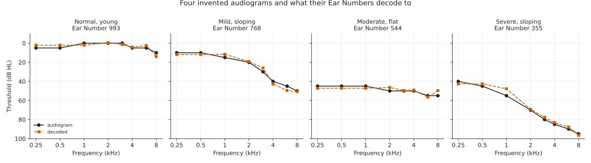
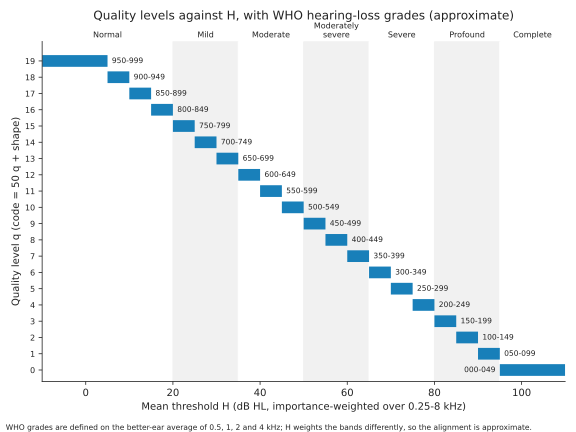
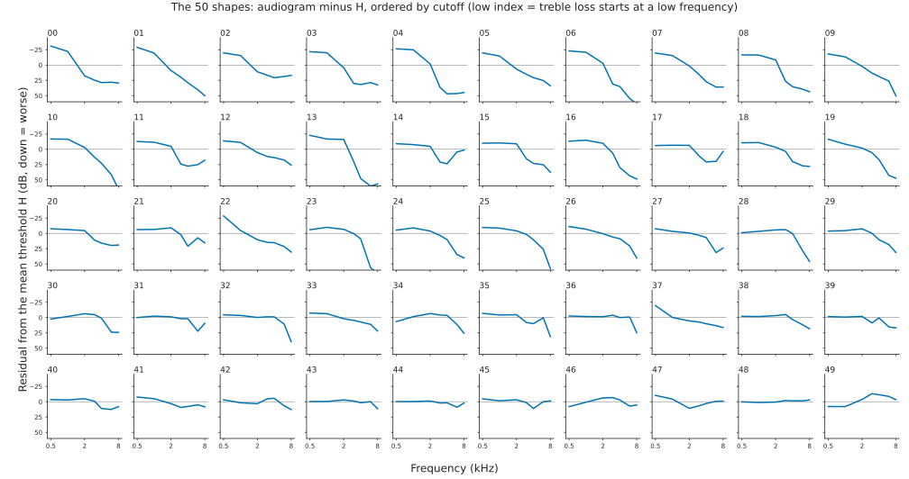

# Ear Number

Ear Number is a three-digit number, from 000 to 999, that says how well one
ear hears. Higher is better: 999 is a healthy young ear and 000 is no hearing
at all. Unlike a single average, it also records the pattern of the hearing
loss, so software can turn the number back into an approximate hearing chart,
and a music player, a pair of earbuds or a hearing aid could set itself up
from six digits typed in by the listener. It is free to use, and everything
needed to check it or rebuild it is in this repository.

## Why hearing needs a number

Hearing has no everyday number like "20/20 vision". A hearing test produces
an audiogram: a chart of the quietest sound an ear can detect at each of
eight or so pitches. It describes an ear well, but nobody remembers theirs,
and it is awkward to type into a device. The usual shorthand, "mild" or
"moderate" loss, is too coarse to set anything up with and says nothing
about which pitches are affected. Two people with a moderate loss can need
quite different help: one has lost the treble and hears vowels but not
consonants, the other hears everything faintly.

Ear Number is meant to be short enough to remember and quote, ordered so
that a bigger number is better hearing, and detailed enough to be useful to
a machine.

## What a number looks like

A person has two numbers, written left ear first, then right ear, then a
check digit:

```text
705 688 4
```

This person's left ear is 705 and their right ear is 688. Both sit in the
"mild loss" part of the scale. The final 4 is a check digit, which lets
software notice a mistyped number, as the last digit of a bank card does.
It is optional but worth keeping.

Decoded, the left ear hears low notes well and loses the treble, while the
right ear is slightly worse overall but more even:

| Ear | 500 Hz | 1 kHz | 2 kHz | 3 kHz | 4 kHz | 6 kHz | 8 kHz |
|---|---|---|---|---|---|---|---|
| Left, 705 | 8 | 13 | 34 | 43 | 48 | 53 | 61 |
| Right, 688 | 31 | 31 | 29 | 28 | 36 | 44 | 51 |

The values are hearing thresholds in dB HL: the quietest tone the ear can
detect at that pitch, where 0 is typical of a healthy young adult and bigger
is worse.



## How to read one

The number answers two questions: how much hearing, and what kind.

**How much.** The scale runs in blocks of 50, and each block is a 5 dB step
in the ear's average threshold (an average weighted towards the pitches that
matter most for speech). A quick rule: subtract the number from 1000 and
divide by ten, and you have that average in dB to within 5 dB. So 705 means
an average threshold a little under 30 dB.

| Number | Average threshold | In everyday terms |
|---|---|---|
| 800-999 | under 20 dB | normal hearing |
| 650-799 | 20 to 35 dB | mild loss |
| 500-649 | 35 to 50 dB | moderate loss |
| 350-499 | 50 to 65 dB | moderately severe loss |
| 200-349 | 65 to 80 dB | severe loss |
| 050-199 | 80 to 95 dB | profound loss |
| 000-049 | 95 dB or more | little or no hearing |

The everyday terms are the World Health Organization's grades. They match
these bands exactly only when the loss is even across the pitches.

**What kind.** Within a block of 50, the position picks one of 50 typical
audiogram shapes: even across the pitches, treble falling away early or
late, a dip around 4 kHz, and so on. Lower positions are shapes whose treble
loss starts at a lower pitch. This part describes; it does not rank. 905 and
940 are equally good ears of different kinds, while 950 is one step better
than 949.

Two things follow when comparing numbers:

- When two numbers are 50 or more apart, the higher one is the better ear on
  this measure, every time. Closer than that, read nothing into which is
  higher.
- A hearing test is not perfectly repeatable, so neither is the number.
  Taking the test again will often change the last two digits and can move
  the number into the next block of 50. Treat a change of 100 or more as
  real.



## Special cases

A few conventions cover ears that were not measured in the usual way.

- **000** means no hearing on that side, or no ear.
- **E** after an ear's digits, as in `456E`, means the number was estimated
  by a self-test on a phone or earbuds, not measured in a clinic. Such
  numbers are rougher, because consumer devices are not calibrated.
- **N** means that ear was not measured and its value is assumed, usually
  copied from the other ear: `456 456N 1`.

## Where the numbers come from

The table behind the number was learnt from real ears, not drawn up by hand.
It uses the hearing tests of 29,061 ears, aged 6 to over 80, from the US
National Health and Nutrition Examination Survey (NHANES), which is public.
The "how much" part is plain arithmetic on the audiogram. The 50 shapes were
found by a clustering method that looks for the most common patterns, with
more weight given to the ages at which hearing loss is common, so that the
shapes are spent where they are needed.

Half of the people were set aside and never used to build the table. On
those unseen ears, the audiogram decoded from the number differs from the
measured one by about 4.5 to 5 dB (median, root mean square across the
pitches). A second hearing test on the same ear typically differs from the
first by about as much, so the number loses little that the test itself
could be relied on to show.



The full method, the evidence and the limits are in [paper.md](paper.md).

## What it is for

Ear Number is a description that people can carry and devices can read.

- **Setting up a device.** A music player, earbuds or a hearing-aid app can
  take the six digits, decode the two audiograms and choose a starting
  adjustment for each ear. The number describes the hearing; how to
  compensate for it is the device's decision, and the listener should still
  be able to trim the result by ear.
- **Saying how you hear.** "I'm 705 and 688" is quicker than reading out a
  chart, and means the same to anyone with the table.
- **Keeping track.** A number from each hearing test shows change over the
  years, within the limits described above.

This is version 1, and nothing uses it yet. It is published so that it can
be examined and tried.

## What it is not

Ear Number describes hearing thresholds and nothing else.

- It is not a diagnosis, says nothing about the cause of a hearing loss, and
  does not replace a hearing assessment.
- It does not capture how well someone follows speech in noise, how loud is
  too loud for them, or tinnitus.
- It knows nothing below 500 Hz or above 8 kHz, because the survey did not
  measure there.
- The shapes come from a survey of the United States, where most hearing
  loss is in the treble. An unusual audiogram, such as a loss mainly in the
  low pitches, gets the right "how much" and the nearest shape available,
  which may not be near.

## Other hearing numbers

Ear Number is not the only way of putting hearing into numbers, and it is
easily confused with the others.

- The **Hearing Number** promoted by Johns Hopkins University
  ([hearingnumber.org](https://hearingnumber.org)) is the average threshold
  at four pitches, in dB. It runs the other way, lower being better, and it
  is a single average with no information about the pattern of the loss.
  Ear Number's "how much" part is a close relative: (1000 - Ear Number) / 10
  usually lands within about 5 dB of it.
- The **WHO grades** (mild, moderate and so on) are bands of that same
  average.
- The **LCH triad** of Humes and Zapala (2024,
  [doi:10.1177/23312165241260041](https://doi.org/10.1177/23312165241260041))
  also gives an ear three digits: one each for the low, centre and high
  pitches, in steps of 10 dB, higher being worse. It needs no table and each
  digit can be read directly. It is a set of three grades, not one ordered
  scale.
- The **standard audiograms** of Bisgaard, Vlaming and Dahlquist (2010) are
  ten typical audiograms used for testing hearing aids. Ear Number's 50
  shapes are the same idea taken further.

## Using the code

`earnumber.py` is the reference implementation and needs only the Python
standard library.

```python
import earnumber as en
n = en.encode({500: 10, 1000: 15, 2000: 25, 4000: 45, 8000: 60})   # dB HL
en.decode(n)              # approximate audiogram, 250-8000 Hz
en.format_pair(n, 688)    # 'LLL 688 C': left, right, check digit
en.parse_pair('705688 4') # reads any written form, verifies the check digit
```

```text
python3 earnumber.py encode 500=10 1000=15 2000=25 4000=45 8000=60
python3 earnumber.py decode 705
python3 earnumber.py check 705 688
```

Thresholds at 500, 1000, 2000, 4000 and 8000 Hz are required; 3000 and 6000 Hz
are optional; a 250 Hz value is accepted but does not affect the number.

## Files

The repository holds the paper, the reference code, the table and the
scripts that rebuild it.

| Path | What |
|---|---|
| `paper.md` | how the number was designed and derived, and how well it works |
| `earnumber.py` | reference encoder, decoder and self-test estimator |
| `earnumber-v1.json` | the version 1 table (weights, 50 shapes, estimator coefficients) |
| `earnumber-v1-vectors.json` | conformance vectors for ports |
| `CITATION.cff` | citation metadata |
| `build/` | scripts that download the public NHANES data and rebuild the table |
| `figures/` | the shapes, the levels and worked examples |
| `tests/` | unit tests: `python3 -m unittest discover -s tests` |

## Rebuilding the table

Three commands download the survey files and rebuild the table from them.

```text
pip install -r build/requirements.txt
python3 build/fetch_nhanes.py
python3 build/build_table.py --check
```

The table is derived from public-use files of the US National Health and
Nutrition Examination Survey (National Center for Health Statistics). It
contains only aggregate values; the raw survey files are not included and
are downloaded from CDC by the fetch script.

## Licence and citation

The code is MIT ([LICENSE](LICENSE)); the paper, table and figures are
CC BY 4.0 ([LICENSE-DATA.md](LICENSE-DATA.md)).

Hill N (2026). Ear Number: a three-digit description of an ear's hearing.
Version 1.
